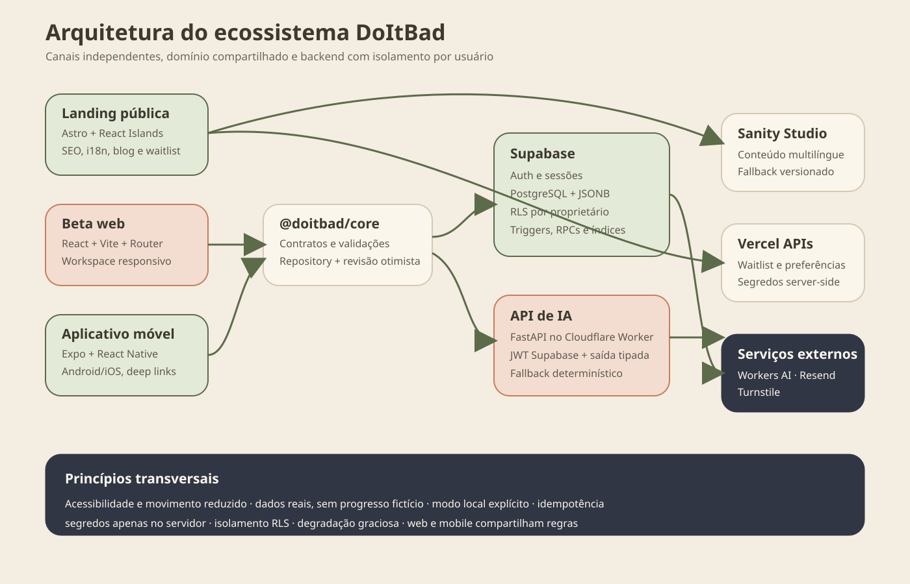
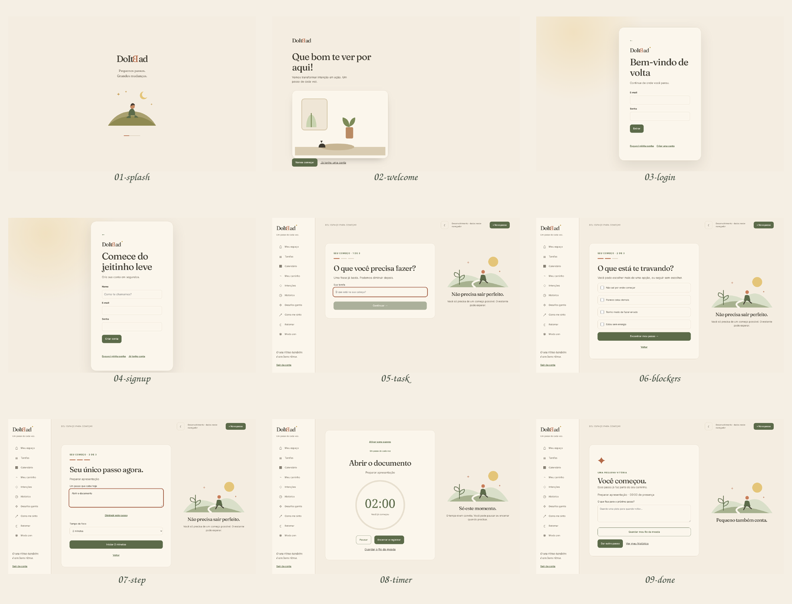
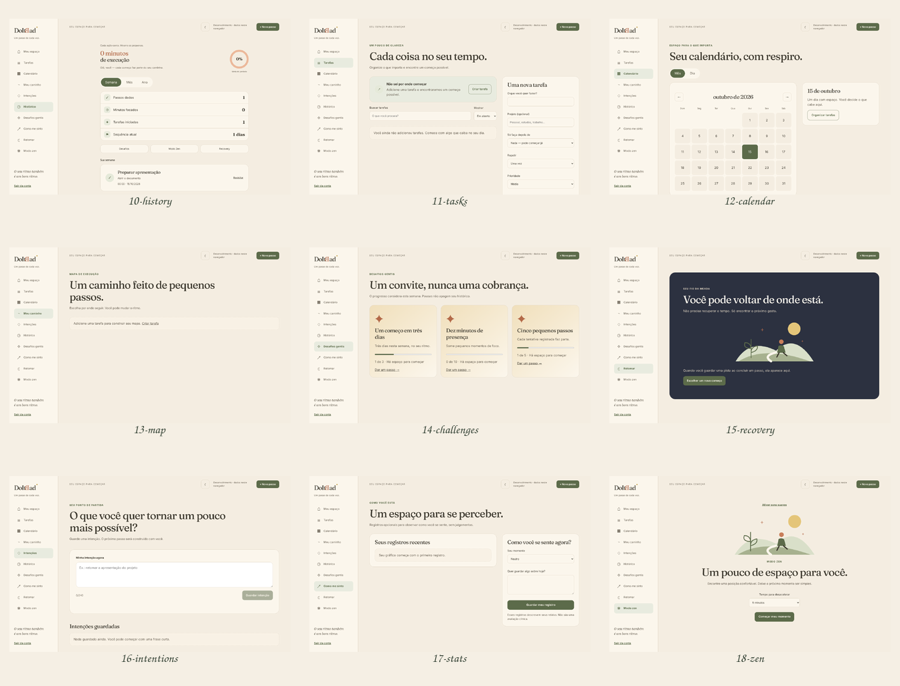
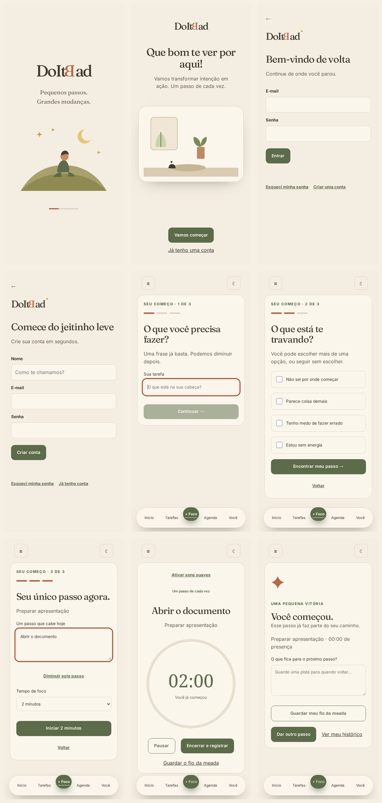
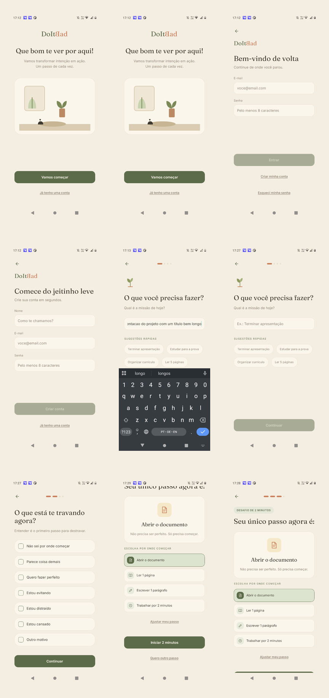
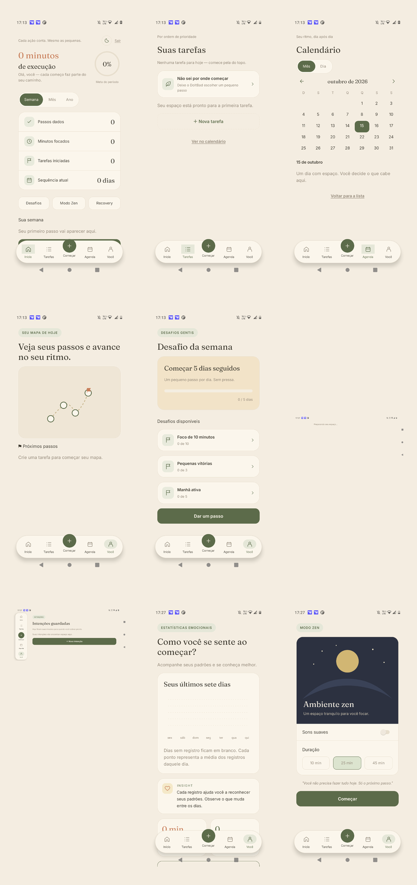
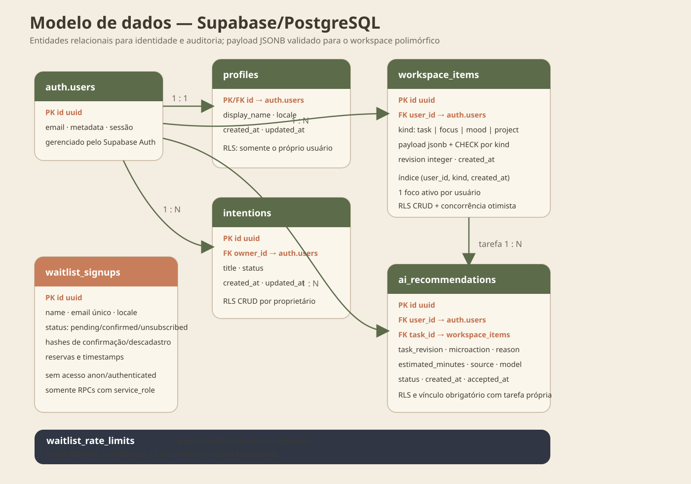
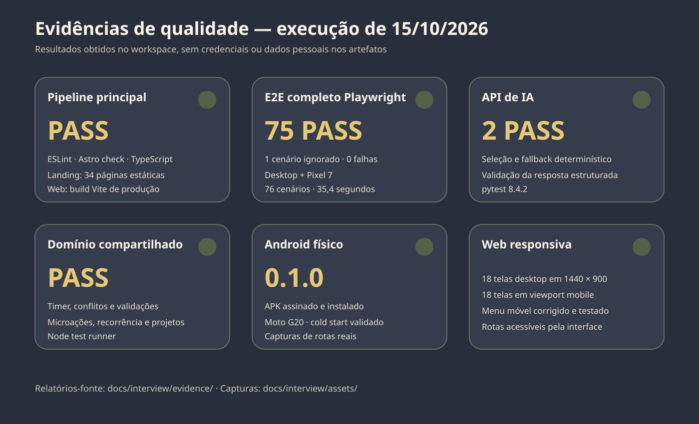
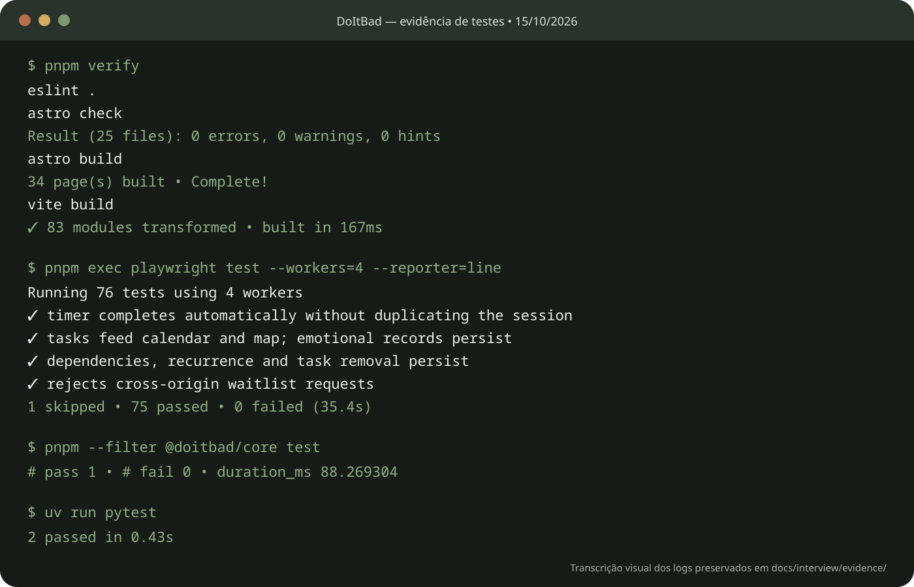

# DoItBad — Dossiê técnico para apresentação

**Produto multiplataforma para transformar intenções em pequenos começos possíveis**  
**Versão documentada:** 0.1.0  
**Data da consolidação:** 15 de outubro de 2026  
**Escopo:** landing page, conteúdo editorial, beta web, aplicativo Android/iOS, domínio compartilhado, backend Supabase e serviço de recomendação por IA.

> Este documento foi produzido a partir do código, das migrações, dos registros de sprint e de execuções reais de build e teste. Ele separa claramente o que está implementado, o que foi validado e o que ainda é débito técnico.


## 1. Resumo executivo

O DoItBad nasce de uma situação simples e recorrente: uma pessoa sabe o que precisa fazer, mas a tarefa parece grande, difusa ou emocionalmente pesada demais para começar. Ferramentas tradicionais de produtividade costumam responder com mais estrutura, mais metas e mais cobrança. O produto explora a direção oposta: reduzir o custo de começar, sugerir uma microação concreta e permitir que a pessoa pare, retome e registre seu ritmo sem transformar o processo em culpa.

A solução evoluiu de uma landing de validação para um ecossistema composto por:

- uma landing internacionalizada e otimizada para conteúdo;
- um funil de lista de espera seguro, com confirmação dupla e proteção contra abuso;
- um beta web autenticado;
- um aplicativo nativo construído com Expo/React Native;
- um pacote de domínio compartilhado entre web e mobile;
- persistência, autenticação e isolamento por usuário no Supabase;
- um serviço de IA que recomenda o próximo passo e mantém fallback determinístico;
- um CMS editorial no Sanity, com fallback versionado para disponibilidade de build.

O projeto não é apenas um conjunto de telas. Ele implementa um ciclo de produto completo: descoberta, comunicação, aquisição, autenticação, planejamento, foco, conclusão, retomada, reflexão e recomendação assistida.

## 2. Apresentação em diferentes durações

### Pitch de 30 segundos

“O DoItBad é uma aplicação web e mobile para pessoas que sabem o que querem fazer, mas têm dificuldade para começar ou retomar. Em vez de pressionar por produtividade, a aplicação quebra uma intenção em uma microação, conduz uma sessão curta de foco e preserva o contexto para a próxima retomada. Construí o produto como monorepo, com Astro na presença pública, React no beta web, Expo no aplicativo, domínio TypeScript compartilhado, Supabase com RLS e um serviço FastAPI de IA com fallback determinístico.”

### Roteiro de 5 minutos

1. Explique o problema da distância entre intenção e ação.
2. Mostre a landing e o fluxo tarefa → bloqueios → próximo passo → timer → conclusão.
3. Mostre a mesma informação em tarefas, calendário, mapa e histórico.
4. Mostre a arquitetura e destaque o pacote `@doitbad/core` compartilhado.
5. Mostre a modelagem, principalmente RLS, revisão otimista e `workspace_items`.
6. Explique que a IA escolhe somente entre tarefas elegíveis e possui fallback seguro.
7. Feche com evidências: verificação estática aprovada, suíte completa com 75 cenários E2E aprovados e zero falhas, testes Python aprovados e APK validado em aparelho físico.

### Roteiro de 15 minutos

Use as seções 3 a 13 como narrativa: problema, princípios, jornada, arquitetura, dados, segurança, IA, qualidade e decisões. Termine com limitações e próximos passos. Mostrar limites reais aumenta a credibilidade técnica: o Android foi validado fisicamente; iOS ainda não foi validado em hardware; a suíte E2E completa está verde em desktop e viewport mobile.

## 3. Problema e oportunidade

### 3.1 Problema observado

Listas de tarefas resolvem bem a pergunta “o que existe para fazer?”, mas nem sempre resolvem “como consigo começar agora?”. O bloqueio pode vir de ambiguidade, cansaço, perfeccionismo, excesso de opções, falta de tempo ou perda de contexto depois de uma interrupção.

Os riscos de uma solução convencional seriam:

- transformar a dificuldade de início em uma falha moral;
- exibir progresso fictício para tornar a interface mais atraente;
- premiar volume em vez de continuidade sustentável;
- produzir recomendações genéricas ou inventadas por um modelo de linguagem;
- manter dados sensíveis somente no cliente sem isolamento entre contas;
- divergir comportamento entre web e aplicativo.

### 3.2 Hipótese de produto

Se a aplicação reduzir uma tarefa a uma ação curta, preservar o contexto e oferecer uma retomada acolhedora, então a pessoa terá menor atrito para iniciar e maior chance de continuar em seu próprio ritmo.

### 3.3 Promessa

“Ajudar a pessoa a começar e retomar no próprio ritmo.”

Essa promessa guiou tanto o texto quanto a arquitetura. Por exemplo, o timer aceita pausa, o histórico não inventa progresso, a recuperação é uma tela de produto, e a IA recebe instrução explícita para evitar cobrança e produtividade tóxica.

## 4. A solução

### 4.1 Ciclo principal

1. A pessoa registra uma tarefa ou intenção.
2. Identifica bloqueios que tornam o começo difícil.
3. Seleciona ou recebe uma microação executável.
4. Inicia uma sessão curta de foco.
5. Pausa, estende ou conclui sem duplicar a sessão.
6. Registra nota, humor e aprendizados.
7. Visualiza o trabalho em lista, calendário, mapa e histórico.
8. Retoma com o contexto preservado.

### 4.2 Módulos funcionais

| Módulo | Responsabilidade | Valor entregue |
|---|---|---|
| Landing | Comunicar a proposta e captar interesse | Validação e aquisição antes do cadastro |
| Editorial | Artigos e práticas localizadas | Educação e aquisição orgânica |
| Autenticação | Cadastro, login, recuperação e sessão | Identidade consistente entre dispositivos |
| Intenções | Registrar algo que a pessoa quer retomar | Menor compromisso inicial |
| Tarefas | Prioridade, etapas, recorrência e dependências | Planejamento real sem perder simplicidade |
| Foco | Timer, pausa, extensão e bloqueios | Converter plano em ação observável |
| Histórico | Sessões e indicadores por período | Reflexão baseada em dados reais |
| Calendário | Visão mensal e diária | Relação temporal das tarefas |
| Mapa | Microações como trilha | Próximos passos visuais e marcáveis |
| Desafios | Convites orientados a comportamento | Experimentação sem ranking punitivo |
| Retomada | Reentrada após interrupção | Continuidade sem culpa |
| Estatísticas | Ritmo, humor e insights | Autoconhecimento, não competição |
| Zen | Ambiente sonoro e sessões de 10/25/45 min | Preparação e regulação antes do foco |
| Recomendação por IA | Escolher tarefa elegível e propor microação | Redução assistida de ambiguidade |

## 5. Resultado atual

O repositório contém aproximadamente 11,5 mil linhas relevantes de TypeScript/TSX/Astro/Python/SQL, sem contar dependências e artefatos gerados. A entrega atual inclui 18 estados/telas de referência implementados em web e mobile, quatro idiomas na camada pública, autenticação real, persistência remota, políticas de segurança por linha, CMS, APIs de lista de espera, serviço de IA e automação de build/teste.

Resultados verificados nesta consolidação:

- `pnpm verify` aprovado: lint, verificações TypeScript/Astro e builds de produção;
- landing gerada com 34 páginas estáticas;
- beta web empacotado com sucesso;
- suíte completa Playwright com 75 testes aprovados, 1 cenário redundante ignorado e zero falhas;
- testes do domínio compartilhado aprovados;
- 2 testes do serviço Python aprovados;
- APK Android de release gerado, instalado e aberto em um Moto G20 conectado;
- capturas reais do fluxo web e de telas Android produzidas;
- serviço editorial demonstrou degradação graciosa: quando o Sanity ficou inacessível no ambiente de teste, o build usou o conteúdo versionado.

## 6. Jornada de construção

### Sprint 0–1: descoberta e linguagem visual

Foi definida a promessa, o posicionamento e a direção “O próximo passo deixa um caminho”. A landing adotou uma estética de papel, argila, creme, sálvia e terracota. Quicksand dá personalidade, Inter preserva legibilidade e o modo noturno comunica pausa e retomada.

A escolha importante aqui foi não publicar números de pesquisa cuja origem ainda apresentava divergência. Isso evita transformar uma peça de comunicação em uma alegação sem lastro.

### Sprint 2: captação utilizável e segura

A lista de espera deixou de ser demonstrativa. Foram adicionados validação, Turnstile, rate limiting atômico, persistência privada, double opt-in, confirmação, cancelamento e integração de e-mail. Tokens são armazenados como hash SHA-256, e falhas no provedor de e-mail liberam a reserva para nova tentativa em vez de informar sucesso falso.

### Sprint 3: operação editorial

O conteúdo ganhou home, índice, artigos, privacidade, preferências e 404 em português, inglês, espanhol e alemão. O Sanity tornou autores, traduções, capas, referências e datas operáveis sem deploy de código. Um fallback local versionado impede que uma indisponibilidade temporária do CMS quebre o build.

### Sprint 5: fundação do beta web

O produto autenticado foi separado da landing. React/Vite ficou responsável pela aplicação dinâmica, enquanto Astro preservou sua vantagem para conteúdo estático, SEO e internacionalização. Supabase Auth, tabelas de perfil/intenção e RLS substituíram o estado exclusivamente local.

### Evolução multiplataforma

As 18 telas de referência foram adaptadas para desktop responsivo e React Native. Regras de tarefa, projeto, foco, humor, revisão e recomendação foram concentradas em `@doitbad/core`. Assim, web e mobile compartilham semântica e armazenamento, mesmo que a apresentação use componentes próprios de cada plataforma.

### IA assistiva

O serviço FastAPI foi adicionado como uma fronteira própria. Ele autentica o token no Supabase, lê apenas tarefas visíveis ao usuário, elimina tarefas concluídas ou bloqueadas por dependências, limita candidatos e pede ao modelo uma saída JSON validada. Qualquer erro de rede, estrutura ou seleção retorna uma decisão determinística.

## 7. Arquitetura do sistema



### 7.1 Visão por camadas

| Camada | Tecnologia | Responsabilidade |
|---|---|---|
| Presença pública | Astro + React islands + Tailwind | Conteúdo, SEO, idiomas, demo e lista de espera |
| Produto web | React + Vite + React Router | Experiência autenticada responsiva |
| Produto mobile | Expo + React Native + Expo Router | Aplicativo Android/iOS e integrações nativas |
| Domínio | TypeScript em `packages/core` | Tipos, validação, repositório e regras compartilhadas |
| Dados/identidade | Supabase Auth + PostgreSQL + RLS | Sessão, persistência, políticas e integridade |
| IA | FastAPI + Pydantic + HTTPX | Recomendação autenticada e fallback |
| Editorial | Sanity Studio | Conteúdo gerenciável, traduções e mídia |
| Funções públicas | Vercel Functions | Lista de espera e preferências |
| Serviços externos | Turnstile, Resend, Cloudflare AI | Antibot, e-mail e inferência |

### 7.2 Fluxo de dados principal

```text
Pessoa → Web ou Mobile → @doitbad/core → Supabase
                              ↓              ↓
                         validação      Auth + RLS

Pessoa → “sugerir próximo passo” → FastAPI → valida JWT no Supabase
                                          → lê tarefas autorizadas
                                          → filtra elegíveis
                                          → Llama ou fallback
                                          → grava recomendação
```

### 7.3 Por que um monorepo

O workspace pnpm permite versionar interfaces, domínio e configuração como uma unidade. Benefícios:

- mudanças de contrato quebram no typecheck antes do deploy;
- web e mobile consomem a mesma versão do domínio;
- um único comando valida várias aplicações;
- documentação, migrações e testes permanecem próximos do código;
- dependências podem ser fixadas e auditadas centralmente.

O custo é maior disciplina no grafo de dependências e nos scripts de CI. O pacote compartilhado deve continuar independente de DOM e APIs nativas para não se tornar um acoplamento acidental.

## 8. Estrutura do repositório

```text
DoItBad-Landing-Page/
├── api/                         # funções serverless da lista de espera
├── apps/
│   ├── ai-api/                  # FastAPI, modelos, gateway e testes
│   ├── mobile/                  # Expo Router e React Native
│   │   ├── app/                 # rotas nativas
│   │   ├── src/                 # telas, tema, auth, dados e visuais
│   │   └── android/             # projeto nativo e APK de release
│   ├── studio/                  # Sanity Studio e schemas editoriais
│   └── web/                     # beta React/Vite
├── docs/                        # sprints, paridade, operação e dossiê
├── packages/
│   └── core/                    # domínio compartilhado web/mobile
├── public/                      # mídia, animações e arquivos públicos
├── scripts/                     # captura, verificação e operação
├── src/                         # landing Astro, componentes e conteúdo
├── supabase/
│   └── migrations/              # evolução reprodutível do banco
├── tests/                       # Playwright: produto, segurança e landing
├── astro.config.mjs
├── eslint.config.mjs
├── package.json
└── pnpm-workspace.yaml
```

Separar aplicações por contexto evita carregar no beta decisões específicas de SEO e evita carregar na landing a complexidade de uma SPA autenticada.

## 9. Escolhas tecnológicas

### Astro para a landing

Astro foi escolhido porque a camada pública é majoritariamente conteúdo. Ele gera HTML estático, permite SEO internacionalizado e hidrata somente os componentes interativos. React islands foram usados onde há estado real, como demo e formulários.

**Benefícios:** menor JavaScript inicial, rotas estáticas, sitemap e metadados claros.  
**Trade-off:** é preciso entender a fronteira servidor/cliente e evitar que uma integração editorial remota torne o build frágil. O fallback local trata esse risco.

### React 19 + Vite para o beta web

O beta exige navegação rica, sessão, formulários e atualização de múltiplas visualizações. React oferece composição e ecossistema; Vite mantém ciclo de desenvolvimento e build simples; React Router organiza rotas e proteção de áreas autenticadas.

**Benefícios:** produtividade, tipagem, componentes reutilizáveis e SPA responsiva.  
**Trade-off:** o cliente recebe JavaScript e precisa de uma estratégia clara de loading/erro. Para uma expansão pública indexável, SSR poderia ser reconsiderado, mas não é requisito central do workspace autenticado.

### Expo/React Native para mobile

Expo permite entregar Android e iOS com TypeScript, roteamento baseado em arquivos e módulos nativos mantidos. SecureStore protege material de sessão no dispositivo, AsyncStorage guarda preferências não sensíveis, e módulos de áudio/data integram funções específicas.

**Benefícios:** uma base móvel, atualização rápida, build EAS e familiaridade com React.  
**Trade-off:** paridade visual não significa compartilhar componentes web; ainda é necessário testar em hardware e lidar com teclado, safe areas, permissões e ciclo de vida.

### Supabase

Supabase reúne PostgreSQL, Auth, API REST e políticas RLS. A escolha evita criar prematuramente um servidor CRUD convencional, mas preserva um banco relacional e migrações SQL explícitas.

**Benefícios:** autenticação, isolamento no banco, realtime opcional e boa experiência TypeScript.  
**Trade-off:** políticas são parte crítica do backend e precisam ser testadas; colocar a chave pública no cliente é correto somente porque autorização real ocorre por JWT e RLS. A chave `service_role` nunca deve ir para web/mobile.

### FastAPI + Pydantic para IA

O serviço de recomendação tem fronteira e ciclo de deploy distintos. FastAPI fornece contratos HTTP explícitos; Pydantic valida entrada e saída; HTTPX suporta chamadas assíncronas ao Supabase e ao provedor de inferência.

**Benefícios:** esquema rigoroso ao redor de uma saída probabilística, documentação automática e código pequeno.  
**Trade-off:** adiciona uma segunda linguagem e operação separada. A justificativa é isolar segredos, reduzir exposição de prompt e permitir evolução independente da IA.

### Sanity para editorial

Conteúdo multilíngue precisa de fluxo de autoria e publicação. O Sanity oferece documentos estruturados, preview, mídia e relacionamento por `translationKey`.

**Benefícios:** conteúdo não depende de alteração no código.  
**Trade-off:** dependência externa durante build. Mitigação: conteúdo local versionado e uso apenas de documentos publicados em produção.

### TypeScript, ESLint, Prettier e Playwright

TypeScript reduz divergências entre telas, payloads e repositório. ESLint captura padrões perigosos, Prettier remove disputa de estilo e Playwright valida fluxos completos em viewports desktop/mobile, além de testar funções de segurança sem depender de chamadas externas reais.

## 10. Experiência e telas

### 10.1 Fluxo inicial web — desktop 1440 × 900



Estas capturas foram executadas no beta web com viewport real de desktop. Nas telas autenticadas, a composição utiliza navegação lateral persistente, cabeçalho com estado de sincronização e ação principal, área central ampla e colunas auxiliares quando o conteúdo se beneficia do espaço horizontal. As telas de entrada permanecem centralizadas por decisão de foco, sem simular uma moldura de celular.

| # | Tela/estado | Decisão de experiência |
|---:|---|---|
| 1 | Splash | Introdução curta e identidade antes do produto |
| 2 | Boas-vindas | Explica o tom e apresenta login/cadastro |
| 3 | Login | Autenticação com mensagens explícitas de falha |
| 4 | Cadastro | Nome, credenciais e confirmação sem rota duplicada |
| 5 | Tarefa | Entrada simples e sugestões para evitar tela vazia paralisante |
| 6 | Bloqueios | Seleção múltipla; voltar não descarta escolhas |
| 7 | Próximo passo | Microação destacada e editável |
| 8 | Timer | Pausa, extensão, retorno e término automático |
| 9 | Conclusão | Celebra sem inflar métricas ou duplicar sessão |

### 10.2 Módulos web — desktop 1440 × 900



O desktop utiliza o espaço disponível e não simula uma moldura de celular. A adaptação preserva conteúdo e identidade, mas muda composição, densidade e navegação de acordo com o ambiente. Os 18 arquivos individuais em resolução integral estão em `assets/web-desktop/`.

### 10.3 Web responsiva — viewport mobile 390 × 844




Estas duas imagens demonstram a responsividade do mesmo aplicativo web e não devem ser confundidas com o aplicativo React Native. Nessa largura, a sidebar dá lugar à navegação compacta e os painéis são reorganizados em uma coluna. Os arquivos individuais estão em `assets/web-mobile/`.

### 10.4 Fluxo Android em aparelho conectado



### 10.5 Módulos Android



As imagens são evidências de execução, não mockups. A captura Android foi feita no aparelho físico conectado. Telas dependentes de uma sessão que ficou inválida durante a automação foram deliberadamente excluídas do mosaico; as equivalentes web permanecem documentadas. Isso evita apresentar um erro de sessão como se fosse o estado final da interface.

## 11. Domínio compartilhado

O pacote `@doitbad/core` concentra conceitos que não pertencem à camada visual:

- `Task`, `Project`, `FocusSession`, `MoodEntry` e tipos auxiliares;
- regras de prioridade, dependência, recorrência e microações;
- validação e normalização de registros antigos;
- escolha determinística do próximo passo;
- abstração de repositório local ou remoto;
- atualização com número de revisão;
- cálculo de timer com `runningSince`, evitando depender apenas de intervalos em memória.

### Revisão otimista

Cada `workspace_item` possui `revision`. Ao atualizar, o cliente envia a revisão conhecida. A operação só deve avançar se o registro ainda estiver naquela versão; depois, a revisão é incrementada. Isso impede que uma edição antiga de um dispositivo sobrescreva silenciosamente uma edição mais nova feita em outro.

### Timer resistente ao ciclo de vida

Um timer apenas decrementado por `setInterval` perde precisão quando a aba ou o aplicativo vai para segundo plano. O domínio armazena tempo acumulado e o instante `runningSince`; ao retornar, calcula a diferença real. Essa decisão melhora consistência entre web e mobile e reduz duplicação de sessões.

## 12. Modelagem de dados



### 12.1 Tabelas

| Tabela | Finalidade | Campos relevantes | Proteção |
|---|---|---|---|
| `auth.users` | Identidade gerenciada pelo Supabase | id, e-mail, metadados | Subsistema Auth |
| `profiles` | Preferências básicas | `id`, `display_name`, `locale`, timestamps | usuário só lê/escreve o próprio perfil |
| `intentions` | Intenções leves | `owner_id`, `title`, `status`, timestamps | CRUD somente pelo proprietário |
| `workspace_items` | Tarefas, focos, humor e projetos | `user_id`, `kind`, `payload`, `revision`, `created_at` | RLS por usuário e validação por tipo |
| `ai_recommendations` | Auditoria das sugestões | tarefa/revisão, texto, motivo, duração, origem, status | usuário e tarefa devem pertencer à mesma conta |
| `waitlist_signups` | Ciclo da lista de espera | nome, e-mail, locale, status, hashes e datas | sem leitura para `anon`/`authenticated` |
| `waitlist_rate_limits` | Janela atômica de abuso | chave, início, tentativas | acesso somente via função privilegiada |

### 12.2 Por que `workspace_items` usa JSONB

Tarefas, sessões, humor e projetos compartilham identidade, proprietário, revisão e data, mas seus atributos evoluem em velocidades diferentes. Um envelope polimórfico reduz a quantidade de endpoints e permite que o mesmo repositório sincronize tipos distintos.

O risco de JSONB seria aceitar qualquer objeto. A mitigação está no banco: `kind` possui enumeração por `CHECK`, e `workspace_payload_shape` valida chaves obrigatórias, tipos, comprimentos, faixas e formatos. Exemplos:

- tarefa exige título, projeto, data, estado e passos;
- foco restringe alvo entre 60 e 7.200 segundos e status a `active|complete`;
- humor aceita somente valores de 1 a 5;
- projeto limita o título e exige cor hexadecimal.

Se consultas analíticas crescerem, atributos mais consultados podem ser promovidos a colunas ou tabelas especializadas. Para a fase atual, JSONB equilibra evolução rápida e integridade.

### 12.3 Integridade e índices

- chaves estrangeiras usam `ON DELETE CASCADE` quando o dado perde sentido sem usuário;
- recomendações usam `ON DELETE SET NULL` para manter auditoria mesmo se a tarefa for removida;
- `workspace_items_owner_kind` acelera leitura por usuário, tipo e data;
- um índice parcial permite somente um foco ativo por usuário;
- e-mail da lista é único em lowercase;
- tokens de confirmação/cancelamento têm índices únicos parciais;
- limites de tamanho e formato são aplicados no banco, não somente na interface.

### 12.4 Row Level Security

RLS é a fronteira final de autorização. O cliente usa uma chave publicável, mas cada consulta é avaliada com `auth.uid()`. As políticas exigem que o `user_id`/`owner_id` coincida com a identidade do token tanto em `USING` quanto em `WITH CHECK`.

Isso protege contra um cliente modificado que tente trocar o proprietário no payload. A lista de espera adota postura ainda mais restritiva: papéis públicos não recebem leitura, e operações sensíveis ocorrem por funções `SECURITY DEFINER` acessíveis apenas ao `service_role` no servidor.

### 12.5 Evolução por migrações

As migrações registram a evolução, na ordem:

1. perfis e intenções;
2. lista de espera;
3. ciclo de confirmação, cancelamento e rate limit;
4. criação automática de perfil;
5. proprietário padrão autenticado;
6. workspace compartilhado;
7. exclusão autorizada;
8. projetos no workspace;
9. recomendações de IA.

Em retorno de versão, a estratégia é não reverter migração destrutivamente: desativa-se a funcionalidade incompatível e preservam-se os dados recebidos.

## 13. Autenticação e sessão

### Web

O cliente Supabase cria conta, autentica, recupera senha e encerra sessão. Rotas do produto são protegidas quando as variáveis de ambiente estão configuradas. A sessão é restaurada no carregamento, e a interface diferencia falhas de autenticação, rede e banco. Sem configuração, um modo local explícito permite desenvolvimento visual, sem fingir que é persistência de produção.

### Mobile

O Expo Router organiza as rotas. A sessão usa armazenamento compatível com o ambiente nativo, com material sensível no SecureStore. Deep links retornam ao aplicativo após os fluxos suportados. Preferências visuais podem permanecer no AsyncStorage porque não são segredo.

### Separação de responsabilidades

- o cliente coleta credencial e mantém sessão;
- o Supabase emite/valida JWT;
- RLS decide acesso aos registros;
- a API de IA revalida o token diretamente em `/auth/v1/user` antes de consultar tarefas;
- nenhum segredo de servidor é empacotado na aplicação.

## 14. Lista de espera e APIs públicas

### Endpoints

| Endpoint | Função |
|---|---|
| `POST /api/waitlist` | valida origem, captcha, dados, limite, cadastro e e-mail |
| `/api/waitlist-preferences` | confirma ou cancela inscrição com token |
| endpoint de diagnóstico protegido | valida integrações sem expor segredos |

### Controles de segurança

- origem é validada antes de serviços externos;
- token Turnstile tem tamanho limitado e ação/hostname conferidos;
- limite de cinco tentativas por hash de IP a cada 15 minutos;
- registro transacional evita dois e-mails simultâneos para o mesmo endereço;
- tokens aleatórios são persistidos somente como hash;
- confirmação dupla reduz cadastro indevido;
- cancelamento funciona por token dedicado;
- `List-Unsubscribe` e `List-Unsubscribe-Post` ajudam clientes de e-mail;
- falha do Resend não produz sucesso enganoso.

## 15. Serviço de IA

### 15.1 Contrato

| Rota | Método | Resultado |
|---|---|---|
| `/health` | GET | estado, modelo configurado e modo de inferência |
| `/v1/recommendations/next-step` | POST | tarefa, revisão, microação, motivo, duração, fonte e modelo |
| `/v1/recommendations/{id}/accept` | POST | marca recomendação como aceita |

### 15.2 Pipeline de segurança e qualidade

1. exige `Authorization: Bearer`;
2. valida o token no Supabase Auth;
3. lê tarefas com o mesmo token, portanto ainda sob RLS;
4. remove tarefas concluídas;
5. remove tarefas com dependências pendentes;
6. ordena por prioridade e criação;
7. limita a cinco candidatas;
8. envia somente campos necessários ao modelo;
9. exige JSON estruturado;
10. valida comprimentos e duração de 1 a 15 minutos;
11. rejeita IDs que não estavam nos candidatos;
12. grava recomendação e revisão da tarefa.

### 15.3 Fallback determinístico

Se a inferência estiver desligada, falhar, responder formato inválido ou escolher uma tarefa inexistente, o sistema continua útil. Ele seleciona a tarefa elegível de maior prioridade e usa a primeira etapa ainda pendente; na ausência de etapa, propõe abrir o material e começar pela tarefa. A fonte fica marcada como `deterministic`.

Essa escolha produz degradação controlada: IA melhora a formulação, mas não é um ponto único de falha. Também evita que o modelo tenha autonomia para criar trabalho ou acessar dados fora do conjunto autorizado.

## 16. Design system e acessibilidade

### Linguagem visual

- creme como base acolhedora;
- sálvia para estabilidade;
- terracota para ênfase e caminho;
- verde carvão e musgo no modo noturno;
- Fraunces na marca, Quicksand em títulos e Inter em leitura longa;
- ilustrações simples e cards com materialidade leve.

### Acessibilidade

O projeto contempla navegação por teclado na camada pública, estados de foco, contraste por tema, textos alternativos, landmarks, mensagens de erro e layouts testados em diferentes viewports. A introdução animada respeita `prefers-reduced-motion`. Testes utilizam Playwright e integração com axe onde aplicável.

O princípio é que animação e ambientação enriquecem a experiência, mas não podem bloquear acesso ao conteúdo. Por isso a intro possui saída por tempo e caminho reduzido, e o conteúdo existe no HTML independentemente da animação.

## 17. Persistência, offline e degradação

Há três comportamentos intencionais:

- **Produção conectada:** Supabase é a fonte de verdade; sessão e RLS definem acesso.
- **Desenvolvimento sem configuração:** repositório local permite trabalhar na interface e deixa claro que é modo local.
- **Serviços auxiliares indisponíveis:** Sanity usa fallback editorial; IA usa recomendação determinística.

O produto ainda não implementa uma fila offline completa com reconciliação posterior. Isso é uma diferença importante entre “fallback de desenvolvimento/degradação” e “offline-first”. Um próximo passo seria manter mutations em fila, idempotency keys e conflitos visíveis usando `revision` como base.

## 18. Qualidade e testes





### 18.1 Pirâmide adotada

| Nível | O que protege | Ferramenta |
|---|---|---|
| Estático | sintaxe, tipos, imports e padrões | TypeScript, Astro Check, ESLint |
| Unidade/domínio | regras de seleção, repositório e timer | Node Test Runner |
| Unidade/serviço | elegibilidade, fallback e contratos | Pytest |
| Integração/E2E | navegação, persistência, estados e segurança | Playwright |
| Build | capacidade de gerar artefato implantável | Astro, Vite, Gradle |
| Visual manual | teclado, safe area, densidade e marca | navegador e Moto G20 físico |

### 18.2 Resultado reproduzido em 15/10/2026

| Execução | Resultado | Observação |
|---|---|---|
| `pnpm verify` | aprovado | lint, Astro check, TS web/studio, build da landing e web |
| `pnpm --filter @doitbad/core test` | aprovado | suíte do domínio |
| `pytest` em `apps/ai-api` | 2 aprovados | serviço e fallback |
| Playwright crítico | 29 aprovados, 1 ignorado | subconjunto rápido de workspace e segurança |
| Build Android release | aprovado | APK gerado e instalado |
| Suíte Playwright completa | 75 aprovados, 1 ignorado, 0 falhas | 76 cenários em desktop e Pixel 7; 35,4 s |

### 18.3 O que os testes críticos cobrem

- splash, boas-vindas, cadastro e login conectados;
- ciclo de foco com recarregamento, pausa e nova tentativa sem duplicação;
- conclusão automática ao chegar a zero;
- tarefas refletidas no calendário e mapa;
- persistência de humor;
- modo noturno em todas as rotas;
- prioridade e microações entre lista, mapa e edição;
- dependências, recorrência e remoção;
- layouts compactos, desktop e paisagem;
- CSP, validação de origem, Turnstile e tokens;
- comportamento correto quando Resend falha.

### 18.4 Regressão encontrada e corrigida

Uma execução interrompida havia produzido 14 falhas/abortos aparentes. Ao repetir a suíte sem interrupção, 73 cenários passaram e restaram duas falhas do mesmo caso em desktop/mobile. O teste ainda esperava textos anteriores ao redesenho; no mobile, ele também revelou uma falha funcional: o cabeçalho oculto removia o botão da sidebar, tornando Histórico e outras rotas secundárias inacessíveis pela interface.

A correção manteve no mobile um cabeçalho compacto com acesso ao menu e ao tema, atualizou as expectativas para o histórico atual e repetiu primeiro o arquivo afetado e depois os 76 cenários. Resultado final: 75 aprovados, 1 ignorado por desenho para evitar repetir a matriz explícita de viewports, e zero falhas.

Os logs e resumos integrais estão em `docs/interview/evidence/`.

## 19. Segurança e privacidade

### Ameaças consideradas

| Ameaça | Mitigação atual |
|---|---|
| leitura de dados de outra conta | RLS por `auth.uid()` |
| alteração do proprietário no cliente | `WITH CHECK` e proprietário padrão no banco |
| segredo no bundle | somente chaves públicas no cliente; segredos no servidor |
| spam da lista | Turnstile + rate limit atômico + double opt-in |
| vazamento de token | armazenamento apenas do hash para confirmação/cancelamento |
| prompt injection via tarefa | modelo só escolhe candidatos; saída validada; sem ferramentas |
| alucinação de ID | resposta conferida contra conjunto elegível |
| sobrescrita concorrente | campo `revision` e atualização otimista |
| dependência externa indisponível | fallback editorial e determinístico |
| e-mail falhar após reserva | liberação da reserva e erro real ao usuário |

### Dados e minimização

O serviço de IA envia título, projeto/tag, prioridade e passos pendentes de no máximo cinco tarefas. Ele não precisa enviar perfil completo, e-mail ou histórico inteiro. Essa minimização reduz exposição e simplifica auditoria.

Para uma produção madura, ainda são necessários política de retenção, exportação/exclusão de conta, inventário formal de suboperadores, telemetria consentida e revisão LGPD.

## 20. Desempenho e confiabilidade

### Decisões atuais

- páginas públicas são pré-renderizadas;
- componentes interativos são hidratados sob demanda;
- fontes e imagens possuem variantes locais/otimizadas;
- conteúdo editorial usa CDN do Sanity;
- consultas têm índices alinhados ao proprietário e ordenação;
- candidatos de IA são limitados antes da inferência;
- timeouts HTTP impedem requisições indefinidas;
- builds não dependem exclusivamente do CMS remoto;
- timer deriva do relógio real ao retomar.

### Métricas que devem entrar na próxima fase

- Core Web Vitals por rota/idioma;
- taxa landing → lista confirmada;
- cadastro → primeira microação;
- tempo até iniciar uma sessão;
- taxa de retomada em 1/7/30 dias;
- aceitação de recomendação por fonte/modelo;
- latência p50/p95 da IA e proporção de fallback;
- erros por versão e dispositivo;
- conflitos de revisão e falhas de sincronização.

As métricas devem medir redução de atrito e continuidade, não estimular uso compulsivo.

## 21. Deploy e distribuição

### Website e beta web

O fluxo recomendado é gerar preview imutável, validar integração, promover o mesmo artefato e manter rollback pelo provedor. Variáveis de ambiente são separadas por preview/produção. Migrações são aplicadas antes da funcionalidade que depende delas.

### Android

Há um APK de teste em:

```text
apps/mobile/android/app/build/outputs/apk/release/DoItBad-0.1.0-android-test.apk
```

SHA-256 verificado:

```text
4e670ac33d92270877f92002136597733883948ff29d000021c580c4be127047
```

Para testers internos, o APK pode ser distribuído por link privado. Para Google Play, o caminho adequado é gerar AAB assinado e usar faixa de teste interno/fechado.

### iOS

O código e os perfis EAS estão preparados, mas não houve validação física iOS nesta rodada. Distribuição ampla por TestFlight exige Apple Developer Program. Desenvolvimento local gratuito pode instalar temporariamente em um iPhone usando uma conta Apple e ferramentas Apple em macOS, mas não substitui TestFlight e possui limitações de assinatura. Portanto, o status correto é “implementado, não validado em hardware iOS”.

## 22. Observabilidade e operação

Hoje, erros são apresentados na interface e os provedores oferecem logs de função/build. Para produção, a arquitetura deveria consolidar:

- correlação por request ID entre cliente, função, IA e Supabase;
- logs estruturados sem conteúdo pessoal;
- alertas para falha de confirmação, aumento de fallback e erros de Auth;
- monitoramento sintético do cadastro e da confirmação;
- rastreamento de versão do cliente em cada erro;
- dashboards de latência e taxa de erro;
- runbook de incidentes e responsável por decisão de rollback.

Não se deve registrar access tokens, hashes utilizáveis, e-mails completos ou conteúdo privado de tarefas em logs de aplicação.

## 23. Principais decisões arquiteturais

### Separar landing e produto

**Decisão:** Astro para conteúdo; React/Vite para workspace.  
**Motivo:** otimizar cada contexto sem forçar uma única ferramenta a servir SEO estático e aplicação autenticada.  
**Alternativa:** Next.js unificado.  
**Por que não agora:** adicionaria servidor/SSR e migração antes de existir necessidade comprovada.

### Compartilhar domínio, não UI

**Decisão:** tipos e regras em `@doitbad/core`; componentes próprios para web e nativo.  
**Motivo:** lógica deve convergir, mas interação, layout e APIs de plataforma são diferentes.  
**Alternativa:** React Native Web para uma UI única.  
**Risco evitado:** compromisso visual ruim e condicionais de plataforma espalhadas.

### Usar RLS como autorização

**Decisão:** toda tabela de usuário aplica políticas no PostgreSQL.  
**Motivo:** mesmo um cliente adulterado não atravessa a fronteira de dados.  
**Alternativa:** API CRUD própria.  
**Trade-off:** políticas SQL tornam-se código de segurança e exigem revisão/teste.

### IA limitada por regras

**Decisão:** regras elegem candidatos; LLM formula/escolhe; Pydantic valida; fallback garante continuidade.  
**Motivo:** preservar utilidade sem entregar autonomia irrestrita ao modelo.  
**Alternativa:** enviar todo o workspace e aceitar texto livre.  
**Risco evitado:** vazamento desnecessário, alucinação e indisponibilidade total.

### Conteúdo com fallback versionado

**Decisão:** Sanity em operação normal e artigos locais no build quando indisponível.  
**Motivo:** editorial gerenciável sem fazer disponibilidade da landing depender de uma única API.  
**Trade-off:** o fallback precisa ser mantido e pode ficar defasado.

## 24. Dificuldades e aprendizados

### Paridade real é mais que criar rotas

Uma rota existente não prova que a tela está concluída. Foi necessário comparar estados internos, teclado, scroll, barras inferiores, transições, tema e persistência. O inventário de 18 telas virou contrato explícito.

### Hardware revela falhas invisíveis no navegador

No Android, a marca era composta por blocos tipográficos e o `d` final podia sofrer corte pelo overhang da Fraunces. A correção separou o glifo, impediu encolhimento flexível e reservou margem óptica. O aprendizado é validar fontes e safe areas em dispositivo, não apenas em screenshot web.

### Automação visual também precisa ser robusta

O dump inicial do UIAutomator sofreu condição de corrida. A captura ganhou repetição assíncrona e limpeza segura de usuários de teste identificados por domínio inválido. Evidências inválidas foram excluídas em vez de tratadas como sucesso.

### Fallback precisa ser exercitado

Durante `pnpm verify`, o ambiente não alcançou o Sanity. O build concluiu usando artigos versionados. Isso demonstrou na prática a resiliência projetada, embora o log de warning deva continuar observável.

### Uma suíte grande pode esconder o sinal

A execução completa mostrou por que é importante diferenciar interrupção do runner, expectativa desatualizada e defeito do produto. A investigação reduziu 14 abortos aparentes a um caso reproduzível, encontrou a rota inacessível no mobile, corrigiu a navegação e restaurou a suíte agregada: 75 aprovados, 1 ignorado e zero falhas.

## 25. Limitações atuais e próximos passos

### Limitações conhecidas

- iOS não foi executado em aparelho físico;
- não existe sincronização offline completa;
- telemetria operacional e produto ainda não está consolidada;
- publicação nas lojas exige contas, assinatura e revisão;
- políticas de retenção/exportação/exclusão LGPD precisam ser formalizadas;
- análise visual automatizada ainda não usa regressão por pixel aprovada;
- acessibilidade precisa de auditoria manual com leitor de tela real.

### Roadmap técnico recomendado

1. manter os 76 cenários Playwright como gate obrigatório no CI;
2. validar iOS em hardware e corrigir diferenças de teclado/safe area;
3. instrumentar erros, latência e funil com privacidade;
4. implementar fila offline e resolução de conflito visível;
5. testar RLS com duas contas em ambiente isolado;
6. adicionar exportação e exclusão de conta;
7. criar ambientes separados de staging e produção para IA;
8. definir SLOs e alertas;
9. gerar AAB e iniciar teste fechado Android;
10. validar hipótese de produto com usuários e ajustar o fluxo com dados qualitativos.

## 26. Perguntas prováveis em entrevista

### “Por que não usar somente React para tudo?”

Porque a landing tem necessidades de HTML estático, SEO, idiomas e conteúdo; o workspace tem sessão e interação rica. Separar os contextos reduz JavaScript público e mantém o produto simples. O domínio, que precisa ser igual, é compartilhado.

### “Por que JSONB em vez de várias tabelas?”

Os registros compartilham ciclo e sincronização, mas mudam de forma rapidamente. JSONB acelera evolução sem abdicar de integridade, pois cada `kind` tem `CHECK` detalhado. Caso analytics ou consultas complexas cresçam, campos quentes podem migrar para colunas/tabelas.

### “A chave do Supabase no frontend é insegura?”

A chave publicável identifica o projeto; não concede acesso irrestrito. A autorização depende do JWT e das políticas RLS. O segredo `service_role` fica somente no servidor. Segurança falharia se as tabelas não tivessem políticas corretas, por isso RLS é tratada como código.

### “Por que um serviço separado para IA?”

Para manter segredos e prompt fora do cliente, autenticar novamente, minimizar dados, validar saída e trocar modelo sem atualizar aplicativos. Também permite desligar inferência e operar com fallback.

### “Como evita a IA inventar uma tarefa?”

O código pré-seleciona tarefas permitidas, envia seus IDs, valida a resposta com Pydantic e confirma que o ID retornado pertence ao conjunto. Se qualquer condição falhar, usa uma regra determinística.

### “Como garante paridade web/mobile?”

Compartilho tipos e regras no core, uso o mesmo backend e mantenho um inventário de 18 telas/estados. Paridade é validada por fluxo e evidência visual; componentes de interface não são forçados a serem iguais.

### “O que você mudaria antes de escalar?”

Estabilizaria o CI completo, validaria RLS e iOS em ambientes dedicados, adicionaria observabilidade, formalizaria LGPD e implementaria sincronização offline. Depois mediria o funil até a primeira microação antes de expandir funcionalidades.

### “Qual foi a decisão mais importante?”

Manter a IA subordinada ao domínio. A recomendação é útil, mas as regras de elegibilidade, segurança e fallback continuam determinísticas. Isso melhora confiabilidade, custo, privacidade e capacidade de explicar o sistema.

## 27. História no formato STAR

**Situação:** havia uma referência visual extensa e a necessidade de transformar a proposta em produto real web/mobile, com dados e autenticação.  
**Tarefa:** implementar o percurso completo sem declarar telas prontas apenas por existirem, preservar privacidade e permitir evolução do conteúdo e da IA.  
**Ação:** separei landing e produto, extraí domínio compartilhado, modelei persistência com revisão e RLS, criei fallback para CMS/IA, adaptei 18 telas, automatizei testes e validei Android fisicamente.  
**Resultado:** ecossistema executável com landing multilíngue, beta autenticado, app Android, build web aprovado, suíte completa com 75 cenários verdes e zero falhas, serviço Python testado e documentação reproduzível. Também identifiquei e registrei o principal limite remanescente: iOS ainda pendente de validação física.

## 28. Comandos de reprodução

### Instalação e validação

```bash
pnpm install --frozen-lockfile
pnpm verify
pnpm --filter @doitbad/core test
pnpm exec playwright test tests/workspace.spec.ts tests/security.spec.ts --workers=4
```

### Desenvolvimento

```bash
pnpm dev
pnpm --filter @doitbad/web dev
pnpm --filter @doitbad/mobile dev
```

### Serviço de IA

```bash
cd apps/ai-api
uv sync --group dev
uv run pytest
uv run uvicorn app.main:app --reload
```

### Android

```bash
pnpm --filter @doitbad/mobile android
pnpm --filter @doitbad/mobile build:preview:android
```

### iOS/TestFlight quando houver conta Apple

```bash
pnpm --filter @doitbad/mobile build:testflight
pnpm --filter @doitbad/mobile submit:testflight
```

## 29. Variáveis de ambiente — categorias

Não inclua valores reais em documentação, commits ou screenshots.

| Contexto | Variáveis/categorias |
|---|---|
| Landing | origem pública, indexação, Sanity publicado/preview |
| Lista | Supabase server, `service_role`, salt, Turnstile, Resend |
| Web | URL Supabase e chave publicável |
| Mobile | URL Supabase, chave publicável e URL da API de IA |
| IA | Supabase, chave publicável, URL/chave/modelo LLM, CORS e timeout |
| Studio | projeto, dataset e host do Sanity |

## 30. Fronteira de escopo

O DoItBad documentado aqui é um produto de apoio a início, foco e retomada. Dados de demonstração sobre ideias corporativas, frota, gestores, líderes ou operadores pertencem a outro domínio e não estão implementados neste modelo. Mantê-los fora deste dossiê evita misturar requisitos e apresentar funcionalidades inexistentes.

## 31. Checklist para a entrevista

- Abra a landing e explique a promessa em uma frase.
- Mostre o mosaico do fluxo antes de abrir código.
- Use o diagrama de arquitetura para orientar a conversa.
- Mostre uma política RLS e um `CHECK` de JSONB.
- Explique revisão otimista e timer por `runningSince`.
- Mostre o pipeline da IA e desligue mentalmente o LLM: o produto continua funcionando.
- Apresente os testes verdes e, em seguida, o débito conhecido.
- Não diga que iOS foi validado; diga que a distribuição está preparada.
- Termine com o que mediria com usuários e o próximo risco técnico a reduzir.

## 32. Evidências anexas

Os arquivos de evidência estão versionados junto deste documento:

```text
docs/interview/assets/       capturas, diagramas e mosaicos
docs/interview/evidence/     saídas integrais de builds e testes
```

Principais registros:

- `verify.txt`: lint, typecheck e builds;
- `critical-e2e-tests.txt`: subconjunto rápido com 29 cenários aprovados;
- `core-tests.txt`: domínio compartilhado;
- `ai-tests.txt`: serviço Python;
- `e2e-tests.txt`: execução completa final com 75 aprovados, 1 ignorado e zero falhas.

---

**Conclusão:** o maior valor técnico do DoItBad está na coerência entre proposta e implementação. A interface reduz pressão; o domínio reduz ambiguidade; o banco reduz acesso indevido; a IA reduz esforço sem assumir controle; os fallbacks reduzem indisponibilidade; e a documentação não oculta os riscos que ainda precisam ser tratados.
